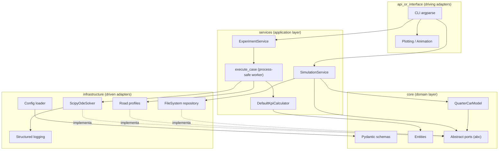

# SuspensionSim

**Motor de simulación de dinámica vertical para un cuarto de vehículo, escrito en Python puro y preparado para producción.**

[](https://www.python.org/)
[](https://numpy.org/)
[](https://scipy.org/)
[](https://docs.pydantic.dev/)
[](LICENSE)

---

## 1. Resumen ejecutivo

SuspensionSim resuelve el modelo lineal de cuarto de vehículo con dos grados de libertad
(masa suspendida y masa no suspendida) bajo excitaciones de carretera deterministas y
estocásticas. El sistema transforma una especificación física validada en una trayectoria
temporal, calcula indicadores de confort y adherencia, persiste artefactos reproducibles y
genera gráficas y animaciones listas para revisión técnica.

El repositorio implementa una arquitectura limpia con inversión de dependencias:

- **Dominio puro** sin dependencias de SciPy, YAML o del sistema de archivos.
- **Puertos abstractos** para solver, perfiles de carretera, KPIs y persistencia.
- **Adaptadores de infraestructura** intercambiables y probados de forma aislada.
- **Servicios de aplicación asíncronos** con paralelismo por procesos para barridos de parámetros.
- **Configuración tipada** con Pydantic v2, composición YAML y variables de entorno.

La migración elimina cualquier dependencia de MATLAB, C++ o C#. Toda la cadena numérica,
la orquestación y la interfaz se ejecutan de forma nativa en Python 3.11+.

---

## 2. Problema y alcance

El documento de origen define el estudio del comportamiento dinámico de una suspensión
automotriz ante irregularidades de la carretera. La versión inicial se limitaba a una
planificación conceptual: no existía un motor de cálculo, un contrato de datos ni una
estrategia de validación.

SuspensionSim cubre el alcance inicial y lo lleva a un estándar de producción:

| Necesidad del documento | Implementación |
| --- | --- |
| Modelo matemático de la suspensión | Sistema de dos grados de libertad con masa suspendida, masa no suspendida, resorte, amortiguador y neumático |
| Resolución numérica | Integradores DOP853, RK45, LSODA y Radau vía SciPy |
| Perfiles de carretera | Bache suave, sinusoide, escalón y rugosidad ISO 8608 reproducible |
| Comparación de configuraciones | Barrido Cartesiano de rigidez y amortiguamiento con ejecución multiproceso |
| Visualización | Gráficas de respuesta, mapas de barrido y animación 2D |
| Documentación y reproducibilidad | Configuración versionada, semillas deterministas, artefactos CSV/JSON y suite de pruebas |

**Fuera de alcance de esta versión:** dinámica lateral, cabeceo y balanceo, suspensión
activa, no linealidades de topes y amortiguadores, validación contra un vehículo físico y
certificación formal ISO 2631.

---

## 3. Capacidades

- Modelo de cuarto de vehículo con estado `[z_s, z_u, v_s, v_u]`.
- Tipado estricto y validación de todos los límites físicos en la frontera del sistema.
- Grilla temporal de hasta 5 millones de muestras por simulación.
- Perfil ISO 8608 generado por suma de sinusoides con PSD y semilla explícita.
- KPIs de confort, recorrido de suspensión, deflexión de neumático y factor de carga dinámica.
- Persistencia atómica en CSV + JSON o JSON único con series completas.
- CLI con subcomandos `simulate`, `sweep` y `profiles`.
- API asíncrona para integrar el motor en un servicio HTTP o una cola de trabajos.
- Logging estructurado JSON con identificadores de correlación.
- Perfiles de vehículo listos para usar: `comfort`, `sport`, `truck`, `offroad`.

---

## 4. Arquitectura

### 4.1 Capas y dirección de dependencias



La regla de dependencia se respeta en una sola dirección: `api_or_interface` y
`infrastructure` conocen al dominio; el dominio no conoce a ninguno de los dos.

### 4.2 Flujo de datos de una simulación

```text
config/base.yaml + profile + entorno
              │
              ▼
        AppConfig (Pydantic, inmutable)
              │
              ▼
      SimulationRequest validado
              │
              ▼
   RoadProfileFactory ──► perfil de carretera
              │
              ▼
   QuarterCarModel (ecuaciones de estado)
              │
              ▼
   ScipyOdeSolver (DOP853 / RK45 / LSODA / Radau)
              │
              ▼
   trayectoria [t, z_s, z_u, v_s, v_u]
              │
              ├──► DefaultKpiCalculator ──► KpiSummary
              │
              ├──► FileSystemSimulationRepository ──► CSV + JSON
              │
              └──► Plotting / Animation ──► PNG / GIF / MP4
```

### 4.3 Patrones aplicados

| Patrón | Ubicación | Propósito |
| --- | --- | --- |
| Ports & Adapters | `core/ports.py` | Aislar el dominio de SciPy, YAML y el filesystem |
| Dependency Injection | Constructores de servicios | Sustituir solver, repositorio y calculadora en pruebas |
| Factory | `RoadProfileFactory` | Resolver el perfil de carretera a partir de un enum validado |
| Value Object | `SuspensionParameters`, `SimulationSettings` | Inmutabilidad y validación en la frontera |
| Repository | `SimulationRepository` | Persistencia atómica e intercambiable |
| Unit of Work | `execute_case` | Caso de barrido picklable para multiprocesamiento |
| Strategy | `OdeSolver`, `RoadProfile` | Intercambiar algoritmos sin modificar el servicio |

---

## 5. Estructura del repositorio

```text
.
├── config/
│   ├── base.yaml                 # Configuración base del cuarto de vehículo
│   ├── dev.yaml                  # Overrides de desarrollo
│   ├── prod.yaml                 # Overrides de producción
│   └── profiles/
│       ├── comfort.yaml
│       ├── sport.yaml
│       ├── truck.yaml
│       └── offroad.yaml
├── docs/
│   └── presentation.md           # Guion ejecutivo de 5 diapositivas
├── src/
│   └── suspension_sim/
│       ├── core/
│       │   ├── entities.py       # SolverOutput, KpiSummary, SimulationResult
│       │   ├── exceptions.py     # Jerarquía de errores tipados
│       │   ├── physics.py        # Modelo de cuarto de vehículo
│       │   ├── ports.py          # Contratos abstractos
│       │   └── schemas.py        # Esquemas Pydantic inmutables
│       ├── services/
│       │   ├── experiment_service.py
│       │   ├── kpi_service.py
│       │   ├── simulation_service.py
│       │   └── sweep_worker.py
│       ├── infrastructure/
│       │   ├── config_loader.py
│       │   ├── logging.py
│       │   ├── repositories.py
│       │   ├── road_profiles.py
│       │   └── solvers.py
│       └── api_or_interface/
│           ├── cli.py
│           └── plotting.py
├── tests/
│   ├── unit/
│   │   ├── test_config_loader.py
│   │   ├── test_kpi_service.py
│   │   ├── test_physics.py
│   │   ├── test_repositories.py
│   │   └── test_road_profiles.py
│   └── integration/
│       └── test_simulation_flow.py
├── .env.example
├── .gitignore
├── pyproject.toml
└── README.md
```

---

## 6. Modelo físico

### 6.1 Ecuaciones de movimiento

Con `z_s` y `z_u` como desplazamientos verticales absolutos de la masa suspendida y no
suspendida, y `z_r(t)` como elevación de la carretera:

```math
m_s \ddot{z}_s = -k_s (z_s - z_u) - c_s (\dot{z}_s - \dot{z}_u)
```

```math
m_u \ddot{z}_u = k_s (z_s - z_u) + c_s (\dot{z}_s - \dot{z}_u) - k_t (z_u - z_r)
```

Forma de espacio de estados utilizada por el integrador:

```math
\frac{d}{dt}
\begin{bmatrix}
z_s \\ z_u \\ v_s \\ v_u
\end{bmatrix}
=
\begin{bmatrix}
v_s \\
v_u \\
\dfrac{-k_s(z_s-z_u)-c_s(v_s-v_u)}{m_s} \\
\dfrac{k_s(z_s-z_u)+c_s(v_s-v_u)-k_t(z_u-z_r)}{m_u}
\end{bmatrix}
```

### 6.2 Supuestos

- Neumático modelado como resorte lineal sin amortiguamiento propio.
- Suspensión lineal; no se modelan topes, fricción seca ni amortiguadores no lineales.
- Acoplamiento vertical puro; se ignoran cabeceo, balanceo y dinámica lateral.
- Carretera rígida y perfil de entrada impuesto, sin interacción neumático-suelo.
- Gravedad omitida del estado dinámico: las ecuaciones describen desplazamientos relativos
  respecto al equilibrio estático. La carga estática se usa solo para normalizar el KPI de
  carga dinámica del neumático.

### 6.3 Frecuencias de referencia

```math
f_n = \frac{1}{2\pi}\sqrt{\frac{k_s}{m_s}}, \qquad
\zeta = \frac{c_s}{2\sqrt{k_s m_s}}, \qquad
f_{hop} \approx \frac{1}{2\pi}\sqrt{\frac{k_s+k_t}{m_u}}
```

---

## 7. Instalación

Requisitos: Python 3.11 o superior. El proyecto se distribuye con `pyproject.toml` y
construcción Hatchling.

### 7.1 Entorno virtual con `venv`

```powershell
python -m venv .venv
.\.venv\Scripts\Activate.ps1
python -m pip install --upgrade pip
python -m pip install -e ".[dev]"
```

```bash
# Linux / macOS
python3.11 -m venv .venv
source .venv/bin/activate
python -m pip install --upgrade pip
python -m pip install -e ".[dev]"
```

### 7.2 Poetry

```bash
poetry install --extras dev
poetry run suspension-sim profiles
```

### 7.3 Conda

```bash
conda create -n suspension-sim python=3.11 -y
conda activate suspension-sim
python -m pip install -e ".[dev]"
```

### 7.4 Verificación

```bash
python -m pytest -q
python -m ruff check src tests
suspension-sim profiles
```

---

## 8. Inicio rápido

### 8.1 CLI

```bash
# Simulación base con gráfica
suspension-sim simulate \
  --label baseline \
  --road smooth_bump \
  --duration 4 \
  --plot artifacts/baseline.png

# Perfil deportivo, sin persistencia, con animación GIF
suspension-sim --profile sport simulate \
  --duration 3 \
  --no-save \
  --animate artifacts/sport.gif

# Barrido de rigidez y amortiguamiento en paralelo
suspension-sim sweep \
  --spring-multipliers 0.75,1.0,1.25 \
  --damping-multipliers 0.5,1.0,1.5 \
  --workers 4 \
  --output artifacts/sweep.csv \
  --plot artifacts/sweep.png

# Catálogo de perfiles con frecuencias derivadas
suspension-sim profiles
```

Las variables de entorno tienen la máxima prioridad:

```powershell
$env:SUSPENSION_SIM__SIMULATION__DURATION_S = "8"
$env:SUSPENSION_SIM__ROAD__KIND = "iso8608"
suspension-sim simulate --no-save
```

### 8.2 API de Python: simulación individual

```python
import asyncio
from pathlib import Path

from suspension_sim.core.schemas import (
    RoadProfileSettings,
    SimulationRequest,
    SimulationSettings,
    SuspensionParameters,
)
from suspension_sim.infrastructure.repositories import FileSystemSimulationRepository
from suspension_sim.infrastructure.solvers import ScipyOdeSolver
from suspension_sim.services.kpi_service import DefaultKpiCalculator
from suspension_sim.services.simulation_service import SimulationService

request = SimulationRequest(
    label="baseline",
    suspension=SuspensionParameters(
        sprung_mass_kg=300.0,
        unsprung_mass_kg=40.0,
        spring_stiffness_n_per_m=25_000.0,
        damping_coefficient_n_s_per_m=1_800.0,
        tire_stiffness_n_per_m=190_000.0,
    ),
    simulation=SimulationSettings(duration_s=4.0, sample_rate_hz=1_000.0),
    road=RoadProfileSettings(
        kind="smooth_bump",
        amplitude_m=0.06,
        bump_length_m=1.2,
        speed_m_per_s=15.0,
        start_distance_m=2.0,
    ),
)


async def main() -> None:
    repository = FileSystemSimulationRepository(Path("artifacts"))
    with SimulationService(
        ScipyOdeSolver(),
        DefaultKpiCalculator(),
        repository=repository,
    ) as service:
        result = await service.execute(request)

    print(f"Muestras: {result.sample_count}")
    print(f"RMS aceleración: {result.kpis.rms_sprung_acceleration_m_s2:.3f} m/s²")
    print(f"Carga dinámica máxima: {result.kpis.max_tire_load_factor:.2f}")


asyncio.run(main())
```

### 8.3 API de Python: barrido multiproceso

```python
import asyncio

from suspension_sim.core.schemas import (
    ExperimentSettings,
    KpiSettings,
    SweepRequest,
)
from suspension_sim.services.experiment_service import ExperimentService


async def run_sweep(base_request) -> None:
    sweep = SweepRequest(
        base=base_request.suspension,
        simulation=base_request.simulation,
        road=base_request.road,
        spring_stiffness_multipliers=[0.75, 1.0, 1.25],
        damping_multipliers=[0.5, 1.0, 1.5],
    )
    service = ExperimentService(
        ExperimentSettings(max_workers=4),
        KpiSettings(),
    )
    report = await service.run(sweep)

    best = report.best_by("rms_sprung_acceleration_m_s2")
    print(f"Mejor caso: {best.label} -> {best.kpis.rms_sprung_acceleration_m_s2:.3f} m/s²")
```

---

## 9. Configuración

La composición sigue un orden determinista:

```text
defaults internos  <  config/base.yaml  <  config/profiles/<perfil>.yaml  <  entorno
```

Ejemplo de override por entorno:

```text
SUSPENSION_SIM__SIMULATION__DURATION_S=8.0
SUSPENSION_SIM__SIMULATION__SOLVER=DOP853
SUSPENSION_SIM__ROAD__KIND=iso8608
SUSPENSION_SIM__ROAD__SPEED_M_PER_S=20.0
SUSPENSION_SIM__PERSISTENCE__OUTPUT_DIR=artifacts
SUSPENSION_SIM__LOGGING__LEVEL=DEBUG
SUSPENSION_SIM__LOGGING__JSON_OUTPUT=false
SUSPENSION_SIM__EXPERIMENT__MAX_WORKERS=8
```

Los escalares se interpretan con el cargador seguro de YAML: `true`, `false`, enteros y
notación científica se convierten antes de la validación de Pydantic.

### 9.1 Perfiles incluidos

| Perfil | Frecuencia de rebote | Amortiguamiento | Uso previsto |
| --- | --- | --- | --- |
| `comfort` | ~1.32 Hz | ~0.43 | Turismo orientado a confort |
| `sport` | ~1.82 Hz | ~0.48 | Respuesta firme y controlada |
| `truck` | ~1.59 Hz | ~0.74 | Masa pesada y alta rigidez de neumático |
| `offroad` | ~1.34 Hz | ~0.47 | Rugosidad ISO 8608 severa |

---

## 10. Entradas de carretera

| Tipo | Descripción | Parámetros relevantes |
| --- | --- | --- |
| `smooth_bump` | Bache de coseno elevado, C¹ continuo | `amplitude_m`, `bump_length_m`, `speed_m_per_s` |
| `sinusoidal` | Excitación armónica espacial | `amplitude_m`, `wavelength_m`, `speed_m_per_s` |
| `step` | Escalón con transición suave de 50 mm | `amplitude_m`, `start_distance_m` |
| `iso8608` | Rugosidad estocástica según PSD ISO 8608 | `roughness_coefficient_m3`, `waviness`, `random_seed` |

La relación espacial-temporal es `x = v · t`. La semilla del perfil ISO 8608 garantiza que
dos ejecuciones con la misma configuración producen exactamente la misma carretera.

---

## 11. Indicadores (KPIs)

| KPI | Unidad | Interpretación |
| --- | --- | --- |
| `rms_sprung_acceleration_m_s2` | m/s² | Nivel global de vibración de la carrocería |
| `peak_sprung_acceleration_m_s2` | m/s² | Evento transitorio más severo |
| `rms_weighted_acceleration_m_s2` | m/s² | RMS filtrado en banda de confort (aproximación ISO 2631) |
| `crest_factor` | — | Relación pico/RMS; detecta transitorios impulsivos |
| `max_suspension_travel_m` | m | Recorrido máximo de suspensión; riesgo de tope |
| `max_tire_deflection_m` | m | Deflexión máxima del neumático |
| `max_tire_load_factor` | — | Carga dinámica normalizada por la carga estática |
| `settling_time_s` | s | Último instante en que la aceleración supera el 2 % del pico |
| `ride_frequency_hz` | Hz | Frecuencia natural de rebote de la masa suspendida |
| `damping_ratio` | — | Relación de amortiguamiento del modo de rebote |
| `wheel_hop_frequency_hz` | Hz | Frecuencia aproximada de salto de rueda |

> El RMS ponderado se calcula con un Butterworth band-pass de cuarto orden entre 0.5 y 80 Hz.
> Es un indicador comparativo reproducible, no una certificación ISO 2631-1.

---

## 12. Experimentación y paralelismo

`ExperimentService` construye el producto Cartesiano de multiplicadores de rigidez y
amortiguamiento. Cada caso se materializa en un `SweepCase` inmutable, picklable y
autocontenido. La ejecución se distribuye con `ProcessPoolExecutor`, lo que evita el GIL y
permite escalar a todos los núcleos disponibles.

```text
k × c casos ──► ProcessPoolExecutor ──► execute_case (por proceso)
                                              │
                                              ├── RoadProfileFactory
                                              ├── QuarterCarModel
                                              ├── ScipyOdeSolver
                                              └── DefaultKpiCalculator
                                              │
                                              ▼
                                    SweepResult ordenado
```

Los resultados se ordenan por rigidez y amortiguamiento, de modo que los reportes y las
comparaciones de regresión son estables independientemente del orden de finalización.

---

## 13. Persistencia y artefactos

Cada simulación genera:

- `YYYYMMDDTHHMMSS_<label>_<uuid>.csv` con una fila por muestra.
- `YYYYMMDDTHHMMSS_<label>_<uuid>.json` con parámetros, KPIs, metadatos y sello temporal.

Las escrituras usan un archivo temporal en el mismo directorio y `os.replace`, por lo que
un proceso interrumpido nunca deja un artefacto truncado. El formato `json_only` incluye las
series completas en un único documento.

---

## 14. Pruebas y calidad

```bash
python -m pytest -q
python -m pytest --cov=suspension_sim --cov-report=term-missing
python -m ruff check src tests
```

Cobertura funcional de la suite:

- Ecuaciones de movimiento, frecuencias naturales y equilibrio.
- Precisión de la grilla temporal y decaimiento de vibración libre.
- Perfiles de carretera deterministas, vectorizados y sensibles a la semilla.
- Cálculo de RMS, factor de cresta, tiempo de estabilización y carga dinámica.
- Composición de configuración, overrides de entorno y errores tipados.
- Persistencia atómica CSV/JSON y repositorio en memoria.
- Flujo asíncrono extremo a extremo, concurrencia y barrido multiproceso.
- Prueba de humo de la CLI con salida JSON verificable.

---

## 15. Rendimiento y escalabilidad

- La integración se delega a DOP853, de orden 8, con tolerancias relativas de `1e-8`.
- El remuestreo se realiza sobre una grilla uniforme para postprocesamiento vectorizado.
- Los KPIs se calculan con NumPy y un filtro IIR aplicado mediante `sosfiltfilt`.
- Los barridos escalan horizontalmente por procesos, no por hilos.
- El perfil ISO 8608 evalúa la suma espectral en bloques de 20 000 muestras para acotar memoria.
- La grilla máxima de 5 millones de muestras protege al proceso de solicitudes abusivas.

Ruta de escalabilidad prevista:

1. Exponer `SimulationService` mediante FastAPI y una cola de trabajos.
2. Persistir series en Parquet o una base de datos de series temporales.
3. Añadir un modelo de vehículo completo con 7 grados de libertad.
4. Incorporar suspensión semiactiva y leyes de control.
5. Validar el modelo contra datos experimentales de un banco de pruebas.

---

## 16. Limitaciones conocidas

- Modelo lineal; no representa topes, fricción seca ni amortiguamiento dependiente de velocidad.
- No incluye dinámica lateral, longitudinal ni acoplamiento de cabeceo y balanceo.
- El perfil ISO 8608 es una realización espectral finita, no un registro medido.
- El RMS ponderado es una aproximación de banda, no la curva Wk completa de ISO 2631-1.
- La validación actual es numérica y de consistencia interna; requiere correlación experimental.

---

## 17. Licencia

MIT. Consulte [LICENSE](LICENSE) para los términos completos.
